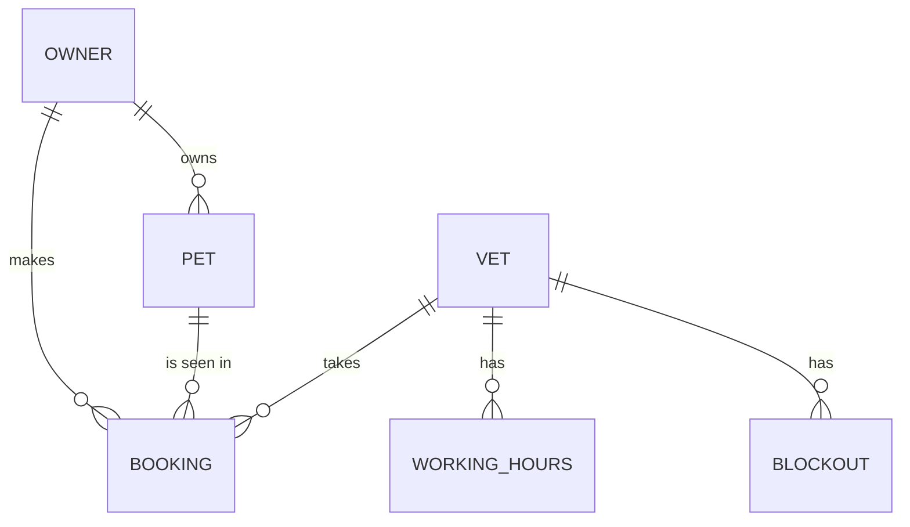

# PawPlan Architecture

## Context

PawPlan is one web application used by pet owners on their phones and by
clinic staff on the front-desk PC. It sends email through an external
provider and stores everything in one managed PostgreSQL database in the EU.
There are no other integrations in the first release.

## Tech Stack

| Layer | Choice | Version | Rationale |
| --- | --- | --- | --- |
| Language | TypeScript | 5.9 | One language across server and browser. |
| Web framework | Next.js | 15 | Server-rendered pages and API routes in one deployable. |
| Database | PostgreSQL | 17 | Exclusion constraints prevent double bookings in the database itself. |
| ORM | Drizzle | 0.44 | Typed queries and plain SQL migrations. |
| Email | Postmark | API v1 | Good deliverability and an EU data region. |
| Hosting | Fly.io (Frankfurt) | n/a | Fits the 50 USD a month budget and keeps data in the EU. |

## Components

| Component | Responsibility | Depends On |
| --- | --- | --- |
| web | Owner and staff pages, API routes, session handling. | db, mailer |
| db | Schema, migrations, and the booking exclusion constraint. | - |
| mailer | Sends transactional email through Postmark. | - |
| scheduler | Hourly job that finds bookings starting in 24 hours and sends reminders. | db, mailer |

## Data Model

A booking holds `vet_id`, `pet_id`, `owner_id`, and a `tstzrange` period. An
exclusion constraint on `(vet_id, period)` makes overlapping bookings for the
same vet impossible.

## Interfaces

Owner and staff pages call JSON API routes under `/api/v1`. Routes are
versioned by path; a breaking change adds `/api/v2` alongside the old version.
The only outbound interface is the Postmark email API.

## Decisions

### AD-001: Single Next.js deployable

- **Status:** accepted
- **Context:** One developer, a small budget, and two user groups that share
  most of the data.
- **Options:** Next.js monolith; separate React SPA plus an API service.
- **Decision:** One Next.js app serving pages and API routes.
- **Consequences:** One thing to deploy and monitor. Splitting later means
  moving API routes into their own service.

### AD-002: Prevent double booking in the database

- **Status:** accepted
- **Context:** G-03 requires zero double bookings, including under concurrent
  requests.
- **Options:** Application-level check inside a transaction; PostgreSQL
  exclusion constraint.
- **Decision:** A PostgreSQL exclusion constraint on vet and time range.
- **Consequences:** Correct under any concurrency. Booking code must turn the
  constraint violation into a "slot taken" response.

### AD-003: Session cookies instead of tokens

- **Status:** accepted
- **Context:** Only our own pages call the API.
- **Options:** HTTP-only session cookies; JWT bearer tokens.
- **Decision:** HTTP-only, SameSite=Lax session cookies backed by a sessions
  table.
- **Consequences:** Easy revocation on logout and password reset. Not suited
  to third-party API clients, which aren't planned.

## NFR Mapping

| NFR | Approach | Verification |
| --- | --- | --- |
| NFR-001 | Index on `(vet_id, period)`; slot search computes free slots in one query. | k6 load test in CI asserts p95 under 300 ms. |
| NFR-002 | argon2id via the `argon2` package with OWASP parameters. | Unit test asserts stored hashes start with `$argon2id$`. |
| NFR-003 | Fly.io Frankfurt region and Postmark EU region only. | Infrastructure config review in every release checklist. |
| NFR-004 | Semantic HTML and the Radix UI primitives. | axe-core checks in end-to-end tests on owner pages. |

## Deployment

Two environments, staging and production, each a Fly.io app with its own
database. Every merge to `main` deploys to staging; a tagged release deploys
to production after a manual approval in GitHub Actions.

## Risks

| ID | Risk | Likelihood | Impact | Mitigation |
| --- | --- | --- | --- | --- |
| TR-001 | Time zone mistakes put bookings at the wrong hour. | medium | high | Store UTC `tstzrange` values; render in the clinic's time zone only. |

## Changelog

| Version | Date | Change |
| --- | --- | --- |
| 1.0.0 | 2026-09-10 | First approved version. |
